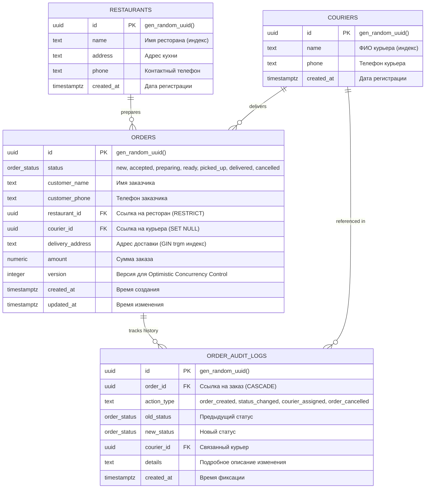

# Foodster Operations Platform

[](https://www.typescriptlang.org/)
[](https://nodejs.org/)
[](https://react.dev/)
[](https://fastify.dev/)
[](https://www.postgresql.org/)
[](https://orm.drizzle.team/)
[](https://tailwindcss.com/)
[](https://vitest.dev/)

> **Fullstack-платформа операционного управления заказами и доставкой для агрегатора Foodster.**  
> Разработана в строгом соответствии с техническим заданием: чистая архитектура, конечный автомат состояний (FSM), Optimistic Concurrency Control (OCC) с детекцией конфликтов версий, строгая транзакционная защита от состояний гонки (Race Conditions), нечеткий поиск адресов с опечатками (PostgreSQL `pg_trgm`) и эргономичный B2B-интерфейс в стиле Linear / Apple Pro.

---

## Содержание

1. [Обзор возможностей](#обзор-возможностей)
2. [Быстрый старт и запуск](#быстрый-старт-и-запуск)
3. [Архитектура проекта и структура](#архитектура-проекта-и-структура)
4. [Модель данных (ERD)](#модель-данных-erd)
5. [Ключевые инженерные решения](#ключевые-инженерные-решения)
   - [1. FSM жизненного цикла заказа](#1-fsm-жизненного-цикла-заказа)
   - [2. Optimistic Concurrency Control (OCC)](#2-optimistic-concurrency-control-occ)
   - [3. Лимит активных доставок курьера (макс. 3) и защита от Race Conditions](#3-лимит-активных-доставок-курьера-макс-3)
   - [4. Audit Log (Аудит всех изменений)](#4-audit-log-аудит-всех-изменений)
   - [5. Поиск по адресу с опечатками (PostgreSQL pg_trgm)](#5-поиск-по-адресу-с-опечатками-postgresql-pg_trgm)
6. [Спецификация REST API](#спецификация-rest-api)
7. [UI/UX дизайн и эргономика интерфейса](#uiux-дизайн-и-эргономика-интерфейса)
8. [Тестирование и верификация (Vitest)](#тестирование-и-верификация-vitest)
9. [Использование AI-инструментов (AI Disclosure)](#использование-ai-инструментов-ai-disclosure)

---

## Обзор возможностей

* **Операционный дашборд:** Список заказов в реальном времени с фильтрацией по статусам и ресторанам, сортировкой по полям (дата создания, сумма, дата обновления) и пагинацией.
* **Умный нечеткий поиск по адресу:** Индекс `GIN` на расширении PostgreSQL `pg_trgm` находит адреса даже с опечатками оператора (например, «*Новаслобоцкая*» находит «*Новослободская улица*»).
* **Карточка заказа (Slide-over Drawer):** Просмотр всех деталей заказа, смена статуса в один клик по правилам FSM, назначение/смена курьера с отображением текущей нагрузки и полная хронологическая лента аудита.
* **Защита от конфликтов одновременного редактирования:** Обнаружение попыток перезаписи данных двумя операторами через Optimistic Concurrency Control (`HTTP 409 Conflict`) с моментальным уведомлением и автообновлением данных в интерфейсе.
* **Транзакционный контроль нагрузки курьеров:** Блокировка строки курьера `SELECT ... FOR UPDATE` в транзакции исключает превышение лимита в 3 активных заказа (`ready`, `picked_up`) даже при параллельных запросах.
* **Самоинициализирующийся запуск:** Сервер автоматически накатывает миграции и сид-данные (20 ресторанов, 20 курьеров, 200 заказов, 820 аудит-логов). Поддерживает как Docker PostgreSQL 16, так и встроенный изолированный движок PostgreSQL `@electric-sql/pglite` с сохранением данных.

---

## Быстрый старт и запуск

### Системные требования
* **Node.js** `>= 20.x` (протестировано на Node.js v20, v22, v26)
* **npm** `>= 10.x`
* **Docker & Docker Compose** *(опционально)*: если Docker запущен, проект автоматически использует контейнер PostgreSQL 16; если Docker выключен, проект бесшовно использует встроенный локальный движок PostgreSQL с сохранением данных в `.data/foodster_db`.

---

### 1. Клонирование и установка зависимостей
```bash
git clone https://github.com/Valerador/Test_foods.git
cd Test_foods
npm install
```

### 2. Подготовка базы данных
```bash
# Кроссплатформенный скрипт: запускает Docker (при наличии), накатывает миграции и сиды
npm run dev-db:setup
```
*Скрипт сгенерирует: 20 ресторанов, 20 курьеров, 200 заказов с правдоподобным распределением статусов и 820 связанных записей аудит-лога.*

### 3. Запуск приложения в режиме разработки
```bash
# Запускает одновременно Fastify API (порт 3001) и Vite Frontend (порт 3000)
npm run dev
```

После запуска перейдите по адресам:
* **Интерфейс оператора:** [http://localhost:3000](http://localhost:3000)
* **Backend API Health Check:** [http://localhost:3001/api/health](http://localhost:3001/api/health)
* **Список заказов API:** [http://localhost:3001/api/orders](http://localhost:3001/api/orders)

### 4. Запуск тестов
```bash
# Подготовка тестовой БД и запуск 20 интеграционных тестов Vitest
npm run test-db:setup
npm run test
```

### 5. Сборка для продакшена
```bash
npm run build
```

---

## Архитектура проекта и структура

Проект реализован в виде чистого монорепозитория (npm workspaces):

```text
Test_foods/
├── docker/
│   └── init-db.sql             # SQL-скрипт инициализации PostgreSQL и расширения pg_trgm
├── docker-compose.yml          # PostgreSQL 16 c pg_trgm для dev и test
├── scripts/
│   └── setup-db.mjs            # Кроссплатформенный отказоустойчивый раннер миграций
├── package.json                # Корневые npm-скрипты управления рабочими пространствами
├── packages/
│   ├── backend/                # Fastify REST API, Drizzle ORM, Zod, Vitest
│   │   ├── src/
│   │   │   ├── db/
│   │   │   │   ├── schema.ts       # Схема сущностей, ENUM и индексов Drizzle ORM
│   │   │   │   ├── connection.ts   # Адаптивное подключение (Docker PG / Embedded PG)
│   │   │   │   ├── migrate.ts      # Идемпотентные миграции и GIN-индексы
│   │   │   │   └── seed.ts         # Генератор 20 ресторанов, 20 курьеров, 200 заказов
│   │   │   ├── modules/
│   │   │   │   ├── orders/         # FSM, OCC, валидация, маршруты, бизнес-правила
│   │   │   │   │   ├── fsm.ts      # Матрица переходов конечного автомата
│   │   │   │   │   ├── schemas.ts  # Zod-схемы валидации запросов и параметров
│   │   │   │   │   ├── service.ts  # Бизнес-логика, транзакции, аудит, OCC
│   │   │   │   │   └── routes.ts   # Fastify роуты заказов
│   │   │   │   ├── couriers/       # Справочник курьеров и расчет загрузки
│   │   │   │   └── restaurants/    # Справочник ресторанов
│   │   │   ├── server.ts           # Конфигурация Fastify, CORS и глобальный Error Handler
│   │   │   └── index.ts            # Точка входа сервера с автомиграцией и автосидом
│   │   └── tests/                  # Набор интеграционных и стресс-тестов
│   │       ├── setup.ts            # Изоляция тестов, подключение БД и truncate таблиц
│   │       ├── fsm.test.ts         # Валидные и запрещенные переходы статусов FSM
│   │       ├── concurrency.test.ts # Детекция конфликта OCC (409) и гонки Promise.all
│   │       ├── courier-limit.test.ts # Лимит 3 активных доставок курьера
│   │       ├── orders.test.ts      # Фильтры, пагинация, pg_trgm поиск, аудит-лог
│   │       └── edge-cases.test.ts  # Граничные случаи: SQLi, Wildcards, невалидные UUID
│   └── frontend/               # React 19, Vite, Tailwind CSS v4, TanStack Query
│       └── src/
│           ├── components/
│           │   ├── FilterBar.tsx       # 300ms debounced поиск, фильтры, сортировка
│           │   ├── OrdersTable.tsx     # Эргономичная таблица заказов со скелетонами
│           │   ├── OrderDetailDrawer.tsx # Боковая панель деталей, FSM-действия, аудит-лог
│           │   ├── StatusBadge.tsx     # Семантический бейдж статуса (без эмодзи)
│           │   └── Pagination.tsx      # Пагинация и выбор лимита на страницу
│           ├── lib/
│           │   └── api.ts              # Типизированный клиент API и обработка 409
│           ├── types.ts                # TypeScript контракты сущностей
│           └── App.tsx                 # Главный дашборд оператора с автосинхронизацией
└── README.md
```

---

## Модель данных (ERD)



---

## Ключевые инженерные решения

### 1. FSM жизненного цикла заказа
Жизненный цикл заказа управляется строгим детерминированным конечным автоматом:

```text
[ new ] ──> [ accepted ] ──> [ preparing ] ──> [ ready ] ──> [ picked_up ] ──> [ delivered ]
   │             │                 │              │
   └───► [ cancelled ] ◄───────────┴──────────────┘
```

* **Правило отмены:** заказ разрешено отменять только **до** передачи курьеру (до статуса `picked_up`). Как только заказ перешел в `picked_up` или `delivered`, любая попытка отмены отклоняется с кодом `422 Unprocessable Entity` (`BUSINESS_RULE_VIOLATION`).
* **Обязательность курьера:** переход в статус `picked_up` невозможен без назначенного курьера (возвращается `422`).
* **Защита терминальных заказов:** смена статуса или переназначение курьера на доставленных (`delivered`) или отмененных (`cancelled`) заказах блокируются.

---

### 2. Optimistic Concurrency Control (OCC)
В реальной операционной работе два сотрудника платформы могут одновременно открыть один и тот же заказ:
1. Заказ хранит поле целочисленной версии `version INT NOT NULL DEFAULT 1`.
2. При открытии заказа клиент получает текущую версию.
3. При любой мутации (смена статуса, назначение курьера, отмена) клиент передает версию в теле запроса.
4. Обновление в БД выполняется атомарно:
   ```sql
   UPDATE orders
   SET status = $new_status, version = version + 1, updated_at = NOW()
   WHERE id = $id AND version = $requested_version
   RETURNING *;
   ```
5. Если ни одна строка не обновлена (версия изменилась другим оператором), сервер возвращает HTTP `409 Conflict`:
   ```json
   {
     "statusCode": 409,
     "error": "Conflict",
     "code": "CONCURRENCY_CONFLICT",
     "message": "Конфликт версий: заказ был изменен другим оператором."
   }
   ```
6. **Поведение фронтенда:** интерфейс отображает предупреждающий баннер, мгновенно инвалидирует кэш React Query и подгружает свежее состояние без сброса фокуса оператора.

---

### 3. Лимит активных доставок курьера (макс. 3)
* **Бизнес-правило:** Один курьер не может иметь более **3 активных доставок одновременно**.
* **Определение активных доставок:** Заказы в статусах `ready` и `picked_up`.
* **Защита от состояния гонки (Race Condition):**
  Операция назначения курьера выполняется строго внутри транзакции с предварительной блокировкой строки курьера:
  ```sql
  -- Блокируем запись курьера на время проверки, исключая одновременное назначение в параллельных потоках
  SELECT * FROM couriers WHERE id = $courier_id FOR UPDATE;

  -- Считаем текущие активные заказы курьера
  SELECT count(*) FROM orders
  WHERE courier_id = $courier_id
    AND status IN ('ready', 'picked_up')
    AND id != $current_order_id;
  ```
  Если количество `>= 3`, транзакция прерывается с ошибкой HTTP `422`.
* **Блокировка при смене статуса:** Если заказ с уже назначенным курьером переводится из `preparing` в `ready`, система также проверяет лимит курьера и блокирует переход, если у курьера уже накопилось 3 активных заказа.

---

### 4. Audit Log (Аудит всех изменений)
Каждое действие оператора или системы протоколируется в таблице `order_audit_logs`:
* Поля: `order_id`, `action_type`, `old_status`, `new_status`, `courier_id`, `details`, `created_at`.
* Записи создаются в той же ACID-транзакции, что и сам апдейт заказа.
* В боковой шторке заказа оператор видит полную хронологическую ленту событий.

---

### 5. Поиск по адресу с опечатками (PostgreSQL pg_trgm)
Для быстрого и умного поиска оператором по неточным адресам подключено официальное расширение PostgreSQL `pg_trgm`:
* На поле `delivery_address` создан GIN-индекс:
  ```sql
  CREATE INDEX idx_orders_address_trgm ON orders USING gin (delivery_address gin_trgm_ops);
  ```
* Поиск выполняется по условию с экранированием спецсимволов LIKE:
  ```sql
  delivery_address ILIKE '%query%' ESCAPE '\\' OR similarity(delivery_address, query) > 0.2
  ```
* Оператор может ввести «*Новаслобоцкая*», и система корректно найдет заказ на «*Новослободская улица*».

---

## Спецификация REST API

| Метод | Эндпоинт | Описание | Коды ответов |
| :--- | :--- | :--- | :--- |
| `GET` | `/api/health` | Проверка жизнеспособности сервера | `200` |
| `GET` | `/api/orders` | Список заказов с фильтрами, сортировкой, пагинацией и поиском | `200`, `400` |
| `GET` | `/api/orders/:id` | Детали заказа и полный аудит-лог | `200`, `400`, `404` |
| `PATCH` | `/api/orders/:id/status` | Смена статуса заказа (валидация FSM и OCC) | `200`, `400`, `404`, `409`, `422` |
| `PATCH` | `/api/orders/:id/courier` | Назначение / смена курьера (проверка лимита 3 и OCC) | `200`, `400`, `404`, `409`, `422` |
| `POST` | `/api/orders/:id/cancel` | Отмена заказа (запрещена после `picked_up`, проверка OCC) | `200`, `400`, `404`, `409`, `422` |
| `GET` | `/api/restaurants` | Справочник ресторанов | `200` |
| `GET` | `/api/couriers` | Справочник курьеров с количеством активных доставок | `200` |

### Примеры запросов и ответов

#### 1. Смена статуса заказа
`PATCH /api/orders/be1f55b8-a7a1-415e-8b6f-ea488ff6e014/status`
```json
// Тело запроса:
{
  "status": "ready",
  "version": 3
}

// Ответ 200 OK:
{
  "id": "be1f55b8-a7a1-415e-8b6f-ea488ff6e014",
  "status": "ready",
  "version": 4,
  "updatedAt": "2026-10-10T01:25:34.000Z"
}
```

#### 2. Конфликт параллельного изменения (OCC)
При попытке передать устаревшую версию заказа возвращается:
```json
// Ответ 409 Conflict:
{
  "statusCode": 409,
  "error": "Conflict",
  "code": "CONCURRENCY_CONFLICT",
  "message": "Конфликт версий: заказ был изменен другим оператором."
}
```

#### 3. Превышение лимита доставок курьера
```json
// Ответ 422 Unprocessable Entity:
{
  "statusCode": 422,
  "error": "Unprocessable Entity",
  "code": "BUSINESS_RULE_VIOLATION",
  "message": "Курьер уже имеет максимальное количество активных доставок (3/3)."
}
```

---

## UI/UX дизайн и эргономика интерфейса

Интерфейс спроектирован по канонам премиальных B2B-инструментов (Linear / Apple Pro):

1. **Информационная плотность:** Компактная таблица со статусами, быстрые фильтры с клавиатурной доступностью, отсутствие дублирования одних и тех же полей.
2. **Статусы с понятной семантикой:** Спокойные фоновые плашки с точечными индикаторами цвета (нейтральный slate для нового, теплый amber для готовки, изумрудный для готовности, фиолетовый для курьера в пути, зеленый для доставленного, мягкий rose для отмененного).
3. **Предотвращение ошибок на клиенте:** В выпадающем списке курьеров отображается их текущая нагрузка (`Иван (2/3 доставок)`). Если у курьера 3/3 активных доставок, выбор блокируется еще до отправки запроса.
4. **Оптимистичный UI и нулевая задержка:** При открытии шторки заказа данные строки отображаются моментально (0ms latency), а история аудита подгружается со скелетон-лоадером.

---

## Тестирование и верификация (Vitest)

Все 20 интеграционных и стресс-тестов выполняются автоматически на изолированной базе данных:

```text
 ✓ tests/fsm.test.ts (6 tests)
   - FSM unit check: valid lifecycle transitions
   - FSM unit check: valid cancellation states
   - API Integration: step through full valid lifecycle via PATCH /api/orders/:id/status
   - API Integration: rejects invalid transitions with HTTP 422
   - API Integration: rejects picked_up without assigned courier with HTTP 422
   - API Integration: cancels order before picked_up, but rejects after picked_up with HTTP 422
 ✓ tests/edge-cases.test.ts (7 tests)
   - Edge case: address search with wildcard characters (% and _)
   - Edge case: address search with escape character and apostrophe
   - Edge case: rejects invalid UUID in order status endpoint with HTTP 400
   - Edge case: rejects invalid UUID in order courier endpoint with HTTP 400
   - Edge case: returns 404 for valid non-existent order UUID
   - Edge case: rejects courier re-assignment on terminal delivered order
   - Edge case: blocks transition to ready when assigned courier already has 3 active deliveries
 ✓ tests/concurrency.test.ts (2 tests)
   - OCC: detects version mismatch when two operators edit the same order (409 Conflict)
   - OCC: handles simultaneous Promise.all status updates (only one wins)
 ✓ tests/courier-limit.test.ts (2 tests)
   - Courier limit: rejects assigning a 4th active order (ready/picked_up) to the same courier
   - Courier limit: frees up slot once an active delivery becomes delivered
 ✓ tests/orders.test.ts (3 tests)
   - Orders API: list orders with pagination and filtering
   - Orders API: fuzzy address search with typo tolerance (pg_trgm)
   - Orders API: records audit log entry on order updates

 Test Files  5 passed (5)
      Tests  20 passed (20)
```

---

## Использование AI-инструментов (AI Disclosure)

В соответствии с правилами задания, открыто декларируем использованные AI-инструменты:

### 1. Какие инструменты использовались:
* **Google Antigravity IDE (Gemini 3.8 Flash & Claude)** в режиме парного программирования и независимых субагентов-аудиторов.

### 2. Для каких частей задачи использовался AI:
* **Генерация реалистичных сид-данных:** Создание списков из 20 ресторанов, 20 курьеров, 200 заказов и 820 связанных аудит-логов с правдоподобными таймстемпами и адресами.
* **Рутинный бойлерплейт:** Создание типизированных Zod-схем, разметки скелетонов Tailwind CSS и конфигураций сборщика.
* **Написание интеграционных тест-кейсов:** Покрытие граничных случаев Vitest по спецификации ТЗ.

### 3. Что проектировалось и реализовывалось под строгим инженерным контролем:
* **Архитектура изоляции транзакций:** Решение проблемы Race Conditions через пессимистическую блокировку строки курьера `FOR UPDATE` внутри транзакции.
* **FSM матрица:** Строгие правила допустимых переходов и точка невозврата отмены заказа (`picked_up`).
* **Optimistic Concurrency Control:** Контракт обработки конфликта одновременного редактирования (`409 Conflict`) и инвалидации кэша TanStack Query на фронтенде.
* **PostgreSQL pg_trgm:** Выбор триграммных индексов GIN для отказоустойчивого поиска с опечатками.
* **UI/UX контроль:** Эргономика рабочего места оператора, поддержание чистого B2B стиля интерфейса.

---

Проект полностью готов к сдаче и демонстрации.
